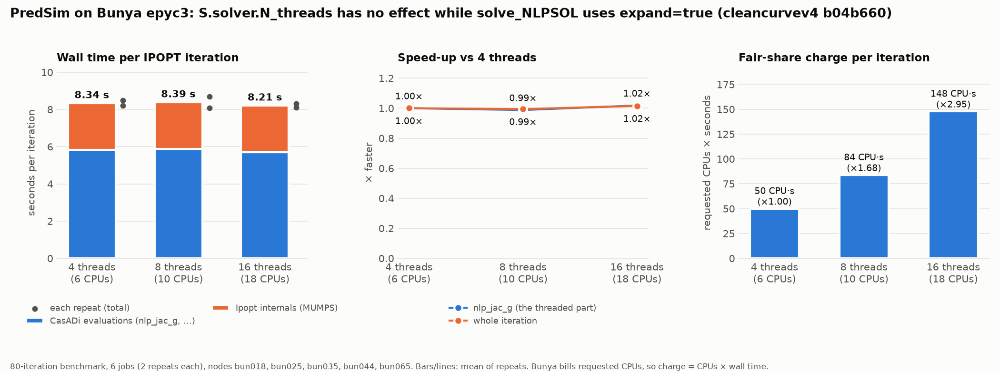
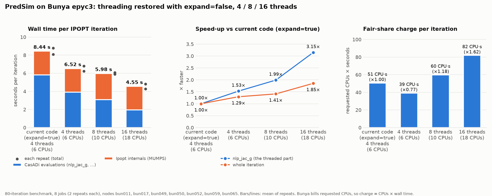

# PredSim on Linux: benchmark findings

What was measured to choose the installer's defaults, and why each choice
was made. The main [README](README.md) has the short version. All results
are from November 2026.

## Summary

| Question | Answer |
|---|---|
| Biggest single speed-up? | Compiling the model's external function with optimisation: **1.8× faster** (8.4 → 4.7 s per iteration). Now the default. |
| CPU-specific flags for it? | `-march=znver3` (FMA, AVX2) makes each call 28% faster on epyc3 and epyc4, about 12% per iteration. Now the Bunya default. `-march=znver4` (AVX-512) is no better. See [section 1b](#1b-cpu-flags-for-the-external-function--marchznver3). |
| Why could Windows be faster on the same hardware? | Mostly that: opensimAD_linux compiled it at `-O0`, Windows at `/O2`. Windows may also use HSL MA97 instead of MUMPS (see [HSL](#hsl-ma97-and-ma57)). |
| HSL instead of MUMPS? | Faster per iteration: MA57 at 1 thread cuts an iteration by about 20% on epyc3 and 38% on epyc4 at no extra CPU. MA97 is fastest on epyc4 with threads, at much higher CPU cost. Time to a solution isn't measured yet. See [HSL](#hsl-ma97-and-ma57). |
| Threads (`S.solver.N_threads`)? | No benefit. The current code is single-threaded, and with the fix it matches 16 threads at about a ninth of the fair-share charge. |
| Multithreaded MUMPS? | Works after a fix, and 16 threads cut an iteration from 4.95 to 3.69 s. That costs about 6× the fair-share charge, and results change from run to run, so it isn't the default. See [Multithreaded MUMPS](#6-multithreaded-mumps). |
| Prebuilt or source CasADi? | Bunya: both are installed and each node uses its faster one: prebuilt on epyc4 (7% faster), source on epyc3 (16% faster). Source-mode builds there were broken until 3 Nov 2026 (see [section 6](#6-multithreaded-mumps)). Ubuntu workstation: source (about 10% faster). |
| Which Bunya CPU? | epyc4 is fastest. Jobs *prefer* it; one install runs on all types. |
| How many CPUs per job? | 2 (one physical core). More gives no speed-up. |

## Method

- **Problem:** subject `Falisse_et_al_2022_scaled75Rajagopal` (3D, 75% scaled
  Rajagopal model, sprint, curved path radius 10 000), from a fixed initial
  guess (`..._radius_10000_speed10dot1_v1.mot`).
- **Fixed work:** 80 Ipopt iterations (`max_iter = 80`), so every run does the
  same computation. Full runs use up to 5000 iterations.
- **Script:** `linux/bench/bench_predsim.m` in the PredSim `linux/cleancurvev4` branch.
  - Environment knobs: `PREDSIM_BENCH_ITERS`, `PREDSIM_BENCH_NTHREADS`, `PREDSIM_BENCH_IG`, `PREDSIM_BENCH_TAG`.
  - It prints Ipopt's timing table. `linux/bench/compare_bench.py` splits that into **CasADi evaluations** (`nlp_jac_g`, `nlp_grad_f`, …) and **Ipopt internals** (mostly the MUMPS factorisation). `linux/bench/plot_threads.py` draws the thread graphs.
- **Repeats:** at least 2 per configuration, on separate jobs (usually separate nodes). Bunya node-to-node noise is about ±5–10%. Single runs differing by less than that aren't meaningful.
- **Cost:** Bunya bills requested CPUs × wall time (and memory), so "charge" is CPUs × seconds per iteration.
- **Same path through the solve:** within one stack the 80 iterations are identical, line for line in Ipopt's log, whatever `N_threads` is, because CasADi's threading is deterministic.
  - Different MUMPS builds (prebuilt vs source: other versions, other METIS ordering) take slightly different paths through the same problem, so stacks are compared per iteration.
  - OpenMP MUMPS isn't deterministic: each run takes its own path.
- **Validity check:** runs whose log has BLAS argument errors (`MKL ERROR ... DTRSM`) are invalid. `compare_bench.py` now warns about them, and the installer's verify step fails on them.

## Where the time goes

Per iteration of the current code before the fix (epyc3, 8.4 s):

| Part | s / iteration | Share |
|---|---|---|
| `nlp_jac_g`: constraint Jacobian, almost all of it in the model's external function `F` | 5.3 | 63% |
| Other CasADi evaluations (`nlp_grad_f`, `nlp_g`, `nlp_f`) | 0.5 | 6% |
| Ipopt internals: MUMPS factorisation and solves | 2.6 | 31% |

`F` (`Subjects/<subject>/F_<subject>.so`) is C code that opensimAD generates
from the OpenSim model: algorithmic-differentiation code for the skeletal
dynamics. **OpenSim itself only runs in preprocessing** (a few seconds) and
isn't part of the per-iteration cost.

## 1. External function optimisation (`-O0` → `-O3`)

**Finding:** opensimAD_linux builds `F` with plain `make install` and no
`CMAKE_BUILD_TYPE`. CMake then passes no `-O` flag, so gcc compiles at **`-O0`**:
the compile command is only `gcc -DF_..._EXPORTS -fPIC -c foo_jac.c`. The
Windows opensimAD builds it with `cmake --build . --config RelWithDebInfo`,
which is MSVC `/O2`.

**Fix:** CMake ≥ 3.22 reads the build type from the `CMAKE_BUILD_TYPE`
environment variable. PredSim's `linux/run_predsim.sh` now exports
`CMAKE_BUILD_TYPE=Release` (`-O3 -DNDEBUG`) unless it is already set, with no
change to opensimAD or PredSim code. The environment pins cmake 3.31.6.

| epyc3, current code, 2 repeats | `nlp_jac_g` per call | s / iteration |
|---|---|---|
| `F` at `-O0` (before) | 5.30 s | 8.44 |
| `F` at `-O3` | 1.87 s | **4.73** (1.78× faster) |

**Cost:** compiling `F` takes about 170 s instead of 20 s, once per model.
PredSim reuses an existing `F_*.so`, so **files built before the change stay
unoptimised until deleted** (`rm Subjects/*/F_*.so`).

## 1b. CPU flags for the external function (`-march=znver3`)

**Question:** `-O3` alone targets generic x86-64, so `F` used no AVX or FMA
instructions at all (0 of about 470k instructions). Would CPU-specific flags help?

**Constraint:** a model's `F_<subject>.so` is one file in
`~/PredSim/Subjects/`, built by whichever job first needs it, on whatever
node that job lands on, then used by every node type. `-march=native` on an
epyc4 node would emit AVX-512 and crash on epyc3. `-march=znver3` runs on
Zen3, Zen4 and Zen5.

**Method:** three builds of the same `F`, passed to CMake as `CFLAGS` with
`CMAKE_BUILD_TYPE=Release`. Ten jobs were submitted together: the
`bench_predsim` problem, 80 iterations, 2 CPUs, 2 repeats, each node type on
the stack it uses by default. Each binary gives exactly the same trajectory on
every repeat. Different binaries take different paths, because FMA rounds
differently. That makes time per call the clean comparison; time per iteration
also depends on the path through Ipopt.

| `F` build | size | FMA instructions | AVX-512 |
|---|---|---|---|
| `-O3` (generic x86-64) | 2.13 MB | 0 | none |
| `-O3 -march=znver3` | 1.52 MB | 47,478 | none |
| `-O3 -march=znver4` | 1.46 MB | 47,479 | 586 instructions |

| Node, stack | `F` build | `nlp_jac_g` per call | evals / iter | s / iteration |
|---|---|---|---|---|
| epyc3, source | generic | 2.18 s (2.15, 2.21) | 2.81 | 5.57 (5.29, 5.84) |
| epyc3, source | **znver3** | **1.57 s** (1.64, 1.50) | **2.15** | 4.72 (5.35, 4.08) |
| epyc4, prebuilt | generic | 1.56 s (1.59, 1.53) | 1.88 | 4.21 (4.32, 4.11) |
| epyc4, prebuilt | **znver3** | **1.12 s** (1.13, 1.11) | **1.41** | **3.70** (3.72, 3.67) |
| epyc4, prebuilt | znver4 | 1.10 s (1.10, 1.09) | 1.40 | 4.08 (4.08, 4.08) |

- **znver3 cuts evaluation time by about a quarter** on both node types: `nlp_jac_g`, which calls `F`, is 28% faster. On epyc4, where Ipopt's own time was the same for both builds (2.33 vs 2.29 s), an iteration is 12% faster.
- **On epyc3 the per-iteration figure is noisy:** three of the four jobs shared one node, and Ipopt's own time ranged from 2.1 to 3.1 s between repeats. The evaluation saving (0.66 s per iteration) is the reliable number.
- **znver4 is no faster per call than znver3.** Its iterations were slower because Ipopt's own time was higher (2.68 s) on the same trajectory as znver3. That has nothing to do with `F` and wasn't investigated. Since znver4 would also need one `F` file per CPU type, it isn't used.
- **Default:** `sites/bunya.env` sets `SITE_EXTFUN_CFLAGS="-march=znver3"`. The installer writes it to `env.sh` as `PREDSIM_EXTFUN_CFLAGS`, and `run_predsim.sh` passes it to the `F` build as `CFLAGS`. The Ubuntu workstation uses `-march=native` (one machine; not benchmarked). As with `-O3`, **existing `F_*.so` files keep their old flags until deleted.**

## 2. Why single-threaded is as fast as multithreaded

PredSim's `OCP/solve_NLPSOL.m` has set `optionssol.expand = true` since
21 Oct 2026. Expanding turns the whole problem, including the
`f_coll.map(N, 'thread', N_threads)` over mesh intervals, into one flat SX
expression graph. A flat graph has no `map` left, so CasADi evaluates it on
one thread and `S.solver.N_threads` has no effect:

| expand=true, epyc3 | CPUs | s / iteration |
|---|---|---|
| `N_threads` = 4 | 6 | 8.34 |
| `N_threads` = 8 | 10 | 8.39 |
| `N_threads` = 16 | 18 | 8.21 |

With `expand = false` the `map` stays and threading works. But the
unexpanded MX graph is much more expensive to evaluate: CasADi interprets
it node by node, with a call into `F` for each mesh interval. Measured as CPU
time (`t_proc`), one `nlp_jac_g` costs **~12.5 s with `expand = false`
against ~1.9 s with `expand = true` and `-O3`**: about 6× more work. The
threads spread that extra work out but can't remove it. And with
`expand = false` the time is no longer in `F` (CPU time was 13.0 s at `-O0`
and 12.4 s at `-O3`), so the `-O3` fix barely helps:

| epyc3, 80 iterations | CPUs | s / iteration | vs current | Fair-share charge |
|---|---|---|---|---|
| current code (`expand = true`), `F` at `-O0` | 2 | 8.4 | 1.00× | 1.00× |
| **current code, `F` at `-O3`** | **2** | **4.7** | **1.78×** | **0.56×** |
| `expand = false`, 4 threads, `-O0` | 6 | 6.5 | 1.29× | 2.3× |
| `expand = false`, 8 threads, `-O0` | 10 | 6.0 | 1.41× | 3.5× |
| `expand = false`, 16 threads, `-O0` | 18 | 4.6 | 1.85× | 4.9× |
| `expand = false`, 4 threads, `-O3` | 6 | 7.6 | 1.11× | 2.7× |

The second limit is **Amdahl's law**. Ipopt's internals (about 2.6 s per
iteration, mostly MUMPS) are serial either way. Even if the Jacobian took
no time at all, an iteration would take about 2.6 s, so 16 threads can at
best roughly halve the time of the unexpanded code.

So the expanded, single-threaded solve with an optimised `F` does the least
total work, and on a cluster that bills per CPU it is by far the cheapest.
**Recommended:** keep `expand = true` and request 2 CPUs (Bunya allocates
whole cores of 2 hardware threads).





*Both graphs use `F` at `-O0`. Draw new ones with `linux/bench/plot_threads.py`.*

## 3. CPUs per job

Same code (`expand = true`, `-O0`) on epyc4 nodes:

| CPUs requested | s / iteration |
|---|---|
| 2 | 6.41 |
| 4 | 6.32 |

The difference is noise. 2 CPUs is one physical core with SMT. **Memory:**
the 3D model peaks at about 10 GB, so jobs request 16 GB.

## 4. CPU types on Bunya

`general` has epyc3 (EPYC 7643, Zen 3), epyc4 (EPYC 9454, Zen 4) and epyc5
(EPYC 9745, Zen 5c, dense cores), all at the same charge rate. Measured
with prebuilt CasADi, `F` at `-O0`, 5 CPUs, 2 repeats:

| Node type | s / iteration |
|---|---|
| epyc4 | **6.8** |
| epyc3 | 8.2 |
| epyc5 | 9.6 |

- epyc4 is about 18% faster than epyc3 and about 30% faster than epyc5. A
  single-threaded solve favours epyc4's higher per-core speed, and epyc5's
  dense cores are slower per thread.
- Only the portable epyc3 build is installed, and it runs everywhere.
- Source builds tuned for the newer CPUs (`-march=znver4`) were also tried. Their timings are **void**: every Bunya source-mode run then had the BLAS bug described in section 6.
- `run_predsim.slurm` uses `--prefer=epyc4`: epyc4 if one is free, otherwise any type. Forcing a type needs both `--constraint=X --prefer=X`, because `--prefer` replaces `--constraint` whenever it can be met.
- With `-O3` all times drop. The ranking should hold, since the work is the same, but it hasn't been re-measured.

## 5. Prebuilt vs source CasADi

| | Ubuntu workstation (i7-7700) | Bunya |
|---|---|---|
| Faster | **source**, about 10% (Ipopt internals 2.2 vs 2.9 s per iteration) | **prebuilt** on epyc4 (the preferred node type); **source** on epyc3. Both installed. |
| Why | MUMPS with METIS ordering and `-O3 -march=native`. CasADi evaluation time is identical. | — |

On Bunya the earlier source-mode timings are void because of the BLAS bug
in section 6. Fixed source build against prebuilt, with each pair submitted
together (current code, `F` at `-O3`, 2 CPUs, 2 repeats, s / iteration):

| Node type | prebuilt | source (fixed) | Ipopt internals, prebuilt / source | Faster |
|---|---|---|---|---|
| epyc4 | **4.12** (4.24, 4.00) | 4.41 (4.02, 4.79) | 2.19 / 2.27 | prebuilt, 1.07× |
| epyc3 | 5.34 (5.62, 5.05) | **4.59** (4.58, 4.59) | 2.89 / 2.11 | source, 1.16× |

- **Bunya installs both by default:** `--prefer=epyc4` is only a preference, so many jobs run on epyc3, where source saves 14% of the time. `~/.predsim/env.sh` reads the node's CPU model at job start and sources the source stack on epyc3 and the prebuilt one elsewhere (`SITE_STACK_BY_ARCH` in `sites/bunya.env`). The cost is about 30 more minutes of install and a second check run. epyc5 keeps prebuilt until the fixed source build is measured there.
- **The external function is shared:** `F_<subject>.so` links only libc/libm, so both stacks use the same compiled file.
- **Contention matters:** an unpaired run of the source stack earlier, with fewer jobs on the node, gave 4.31 s against 4.95 s for prebuilt. Compare stacks with jobs submitted together.
- **Source takes a different path on epyc3 and epyc4:** its OpenBLAS picks different kernels per CPU (`DYNAMIC_ARCH`), so the rounding differs. Prebuilt took the same path on both.

The Ubuntu source stack never had the bug (no BLAS errors in any local log).
It uses spack's OpenBLAS, not the installer's pthreads build.

Neither mode needs the old SWIG fork or gcc 7. CasADi's source-release
archive ships pre-generated MATLAB wrappers (`SWIG_IMPORT=ON`).

## 6. Multithreaded MUMPS

MUMPS can use threads in two ways: through a threaded BLAS, or built with
OpenMP (ThirdParty-Mumps `--enable-openmp`, the installer's `--mumps-openmp`).

### Threaded BLAS: slower

Prebuilt stack, `expand = false`, `F` at `-O0`, `N_threads` = BLAS threads = T:

| epyc3 | T = 4 | T = 8 | T = 16 |
|---|---|---|---|
| single-threaded BLAS: s / iteration (internals) | 6.52 (2.61) | 5.98 (2.89) | 4.55 (2.59) |
| `OPENBLAS_NUM_THREADS` = T: s / iteration (internals) | 7.36 (3.08) | 6.15 (3.35) | 6.39 (4.03) |

MUMPS's dense frontal matrices are small for this sparse problem, so BLAS
threads spend more time synchronising than computing.

### OpenMP MUMPS: a Bunya build bug, then a real speed-up

The first OpenMP build gave thousands of
`Intel MKL ERROR: Parameter 11 was incorrect on entry to DTRSM` lines, a
different path from iteration 2, and runs about 10× slower that hit the 2 h
limit. The cause turned out to be **every source-mode build on Bunya, with
or without OpenMP**, not OpenMP itself:

- The ordinary source stack had the same errors in every run, and its solve diverged: in restoration at iteration 80 with objective 1.4×10⁸, against about 70 for good runs. Its verify step passed because it only checked that the iterations ran.
- **Ruled out: misrouted BLAS calls.** A dynamic-linker trace (`LD_DEBUG=bindings`) shows MUMPS's `dtrsm_` bound to OpenBLAS, not to MATLAB's MKL. The "Intel MKL" text appears only because OpenBLAS reports bad arguments through `xerbla_`, a weak symbol that MATLAB's MKL overrides.
- **What it depends on:** MUMPS linked to the installer's pthreads OpenBLAS 0.3.32 build got bad arguments in OpenBLAS's `dtrsm`. The same MUMPS linked to an **OpenMP build of the same OpenBLAS** (`USE_OPENMP=1`) is clean: install check, 8 benchmark runs, no errors, normal solves. The exact trigger inside the pthreads build wasn't isolated. It doesn't show on a small test problem, only on PredSim's.
- **Fix (installer, 3 Nov 2026):** on Bunya, source-mode MUMPS always links the OpenMP OpenBLAS, built as `libopenblasomp.so.0`.
  - The separate name keeps it apart from the pthreads `libopenblas.so.0`, which MATLAB loads through OpenSim's JNI first. Under the same name the loader would reuse the copy already loaded.
  - `--mumps-openmp` only decides whether MUMPS itself uses threads.
  - The verify step now fails on BLAS argument errors.
- **Not affected:** the prebuilt stack (Bunya's default), which bundles its own OpenBLAS, and every prebuilt result here.

Results with the fixed build. Current code (`expand = true`), `F` at `-O3`,
epyc3, all 12 jobs on one node (bun048), 2 repeats each, `OMP_NUM_THREADS` = T:

| Stack | CPUs | s / iteration | Ipopt internals | vs prebuilt | Fair-share charge |
|---|---|---|---|---|---|
| prebuilt, single-threaded (default) | 2 | 4.95 | 2.65 | 1.00× | 1.0× |
| OpenMP MUMPS, T = 1 | 2 | 5.50 | 2.93 | 0.90× | 1.1× |
| OpenMP MUMPS, T = 4 | 4 | 4.63 | 2.22 | 1.07× | 1.9× |
| OpenMP MUMPS, T = 8 | 8 | 4.47 | 2.04 | 1.11× | 3.6× |
| OpenMP MUMPS, T = 16 | 16 | 3.69 | 1.30 | 1.34× | 6.0× |

- Threads only speed up the MUMPS part (2.9 → 1.3 s). The CasADi evaluations (about 2.4 s, single-threaded) are untouched, so 16 threads give 1.34×.
- **OpenMP MUMPS isn't deterministic.** At iteration 80 the objective was 67.8, 69.3 and 69.5 for 16, 1 and 4 threads, and 153.6 in one 8-thread run. Converged results should agree, but runs can't be reproduced exactly.
- **Verdict:** only worth it when wall time matters much more than fair share. The default stays prebuilt and 2 CPUs. To use it:

  ```bash
  sbatch --export=ALL,CASADI_MODE=source,PREDSIM_INSTALL_ARGS=--mumps-openmp bunya/install_predsim.slurm
  sbatch --cpus-per-task=16 --export=ALL,OMP_NUM_THREADS=16 bunya/run_predsim.slurm
  ```

## HSL MA97 and MA57

The Windows PredSim uses Ipopt's `linear_solver = ma97` (HSL) when
`C:\CoinHSL...\bin\libhsl.dll` exists, and MUMPS otherwise. On Linux it
always used MUMPS: the check looked only for the Windows path. Now:

- **PredSim:** `solve_NLPSOL.m` takes the library from `$PREDSIM_HSL_LIB` on Linux, and the solver from `$PREDSIM_HSL_SOLVER` (default `ma97`).
- **Installer:** `--hsl ARCHIVE` builds CoinHSL into each stack and sets `PREDSIM_HSL_LIB`.
- **CoinHSL is licensed:** download it yourself from <https://licences.stfc.ac.uk/product/coin-hsl>. It's free for academic use.
- **MATLAB's own MA57 can't be used:** `libmwma57.so` is built with 64-bit integers, and Ipopt calls it with 32-bit ones (`MA57AD ... NE has value****`).

**Method:** CoinHSL 2024.05.15 from source, with METIS. The `bench_predsim`
problem (about 149k variables), 80 iterations, the `znver3` external function,
2 repeats, 36 jobs submitted together, each node type on its default stack.
Each job had `max(2, T)` CPUs and 32 GB (peak use was about 10 GB for all).
MA97's threads come from `OMP_NUM_THREADS`. MA57 has none of its own, so its
threads come from BLAS (`OPENBLAS_NUM_THREADS`). No run had BLAS errors.

Seconds per iteration, repeats in brackets. "Solver" is Ipopt's own time
(total minus function evaluations, mostly the linear solver):

| Node, stack | Solver | Threads | s / iteration | Solver s / iter | CPU ÷ elapsed | CPUs × s / iter |
|---|---|---|---|---|---|---|
| epyc3, source | MUMPS | 1 | 4.35 (4.38, 4.31) | 2.19, 2.14 | 1.0 | 8.7 |
| | **MA57** | **1** | **3.46** (3.46, 3.47) | **1.31, 1.27** | 1.0 | **6.9** |
| | MA57 | 4 | 3.46 (3.56, 3.36) | 1.42, 1.36 | 1.2 | 13.8 |
| | MA57 | 8 | 3.84 (3.38, 4.29) | 1.32, 2.23 | 1.5 | 30.7 |
| | MA57 | 16 | 3.34 (3.13, 3.55) | 1.27, 1.51 | 2.1 | 53.4 |
| | MA97 | 1 | 4.08 (4.16, 4.00) | 1.99, 1.93 | 1.0 | 8.2 |
| | MA97 | 4 | 3.33 (3.58, 3.08) | 1.47, 1.16 | 1.3 | 13.3 |
| | MA97 | 8 | 3.58 (3.07, 4.10) | 1.03, 1.95 | 1.6 | 28.6 |
| | MA97 | 16 | 4.06 (2.96, 5.17) | 1.09, 2.42 | 2.2 | 65.0 |
| epyc4, prebuilt | MUMPS | 1 | 4.60 (3.72, 5.47) | 2.29, 3.88 | 1.0 | 9.2 |
| | **MA57** | **1** | **2.63** (2.32, 2.93) | **0.87, 1.28** | 1.0 | **5.3** |
| | MA57 | 4 | 2.42 (2.35, 2.49) | 0.94, 1.03 | 1.3 | 9.7 |
| | MA57 | 8 | 2.50 (2.68, 2.31) | 1.16, 0.89 | 1.7 | 20.0 |
| | MA57 | 16 | 2.77 (2.93, 2.62) | 1.35, 1.17 | 2.7 | 44.3 |
| | MA97 | 1 | 3.88 (2.70, 5.05) | 1.26, 2.24 | 1.0 | 7.8 |
| | MA97 | 4 | 2.27 (2.14, 2.41) | 0.75, 0.89 | 1.2 | 9.1 |
| | MA97 | 8 | 2.14 (2.17, 2.12) | 0.73, 0.71 | 1.3 | 17.1 |
| | MA97 | 16 | **2.05** (2.15, 1.95) | 0.75, 0.57 | 1.6 | 32.8 |

- **HSL is a real speed-up per iteration.** Single-threaded MA57 takes about 40% of MUMPS's solver time on epyc4 and 60% on epyc3. An iteration is about 20% faster on epyc3 (4.35 → 3.46 s) and, comparing each solver's faster repeat on epyc4, about 38% faster (3.72 → 2.32 s).
- **MA57 at 1 thread is the best value:** the lowest CPU cost per iteration on both node types.
- **MA97 is the fastest on epyc4 when given threads** (2.05 s at 16), but costs about 6× the CPU of MA57 for 11–22% less time. It needs threads to pay off: at 1 thread it is slower than MA57 on both node types.
- **Threaded BLAS doesn't help MA57.** Its solver time doesn't improve with threads. CPU use rises, so the extra threads mostly wait.
- **Scaling is limited** because function evaluations (1.4–2.2 s per iteration) are serial, whichever solver runs.
- **Noise:** several repeats differ by more than the gaps between configurations (2.70 vs 5.05 s for MA97 at 1 thread on epyc4). These jobs ran on different, busy nodes. Treat small differences as unresolved.

**80 iterations can't settle which solver is best overall.** Each solver takes a
different path. Iterates reproduce exactly between repeats, but these differ
widely at iteration 80:

| Node, stack | MUMPS | MA57, 1 thread | MA97, 1 thread |
|---|---|---|---|
| epyc3, source: objective / constraint violation | 67.2 / 2.4e+04 | 71.1 / 6.7e+03 | 127.3 / 2.8e+03 |
| epyc4, prebuilt: objective / constraint violation | 71.4 / 6.9e+03 | 73.3 / 5.7e+03 | 92.6 / 7.5e+01 |

MA97 has the lowest constraint violation at this point, but none of these runs
has converged, and that gap may not last. Time to a solution needs runs to
convergence, which haven't been done. Whether the source stack is still the
faster one on epyc3 with HSL hasn't been measured either.

### Making HSL work inside MATLAB

MATLAB's global symbols replaced HSL's calls in the source stack. MATLAB's
`libmwmetis`, `libmwma57` and `mkl.so` use 64-bit integers, and HSL uses 32-bit:

| Call from `libhsl` | Went to | Result |
|---|---|---|
| `METIS_SetDefaultOptions` | `libmwmetis` | Segfault in METIS. Its disassembly shows 64-bit writes for 40 options, which would be 320 bytes into HSL's 160-byte array. |
| `ma57gd_` (HSL's own routine) | `libmwma57` | Segfault |
| `DGEMM`, `DSWAP`, `dtpsv_` | `mkl.so` | `MKL ERROR`s, then a segfault |
| OpenMP (`GOMP_task` and others) | `libiomp5` | Restoration at iteration 1, DGEMM errors, out of memory |

The source stack alone failed because of how Ipopt loads HSL. CasADi's official
Ipopt calls `dlopen` with `RTLD_NOW | RTLD_DEEPBIND`, which makes a library
prefer its own dependencies. Upstream Ipopt 3.14 uses plain `RTLD_NOW`.

**Fix:** the source build now patches Ipopt to use `RTLD_DEEPBIND`, and `libhsl`
links METIS and OpenBLAS statically with `-Bsymbolic`. Traces with
`LD_DEBUG=bindings` on both stacks show no calls from `libhsl` into MATLAB's
libraries or MKL, and OpenMP calls going to `libgomp`.

## Reproducing

```bash
# one benchmark run (any stack env file), 80 iterations
sbatch --constraint=epyc3 --prefer=epyc3 \
  --export=ALL,PREDSIM_ENV=<stack>/env.sh,PREDSIM_SCRIPT=linux/bench/bench_predsim,PREDSIM_BENCH_ITERS=80,PREDSIM_BENCH_IG=<guess.mot> \
  bunya/run_predsim.slurm
# compare logs / draw the thread graph
python3 -I ~/PredSim/linux/bench/compare_bench.py predsim-*.out
python3 -I ~/PredSim/linux/bench/plot_threads.py out.png predsim-*.out --cpus-offset 2
```

Run concurrent jobs from a checkout whose `F_*.so` already exists, or each
job compiles its own copy at the same time.
